  
  

---

Me chamo **Ryan**. Estudo desenvolvimento web e de sistemas e aplico o que aprendo em projetos de dashboard, port e tradução de jogos retrô.

---

### Onde me encontrar

### Minha stack

### Estatísticas do GitHub

  
  

